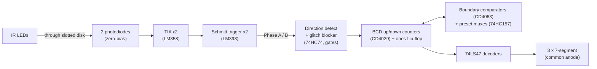

# Optic Angular Position Encoder: KiCad PCB

A complete KiCad 10 schematic and 2-layer PCB of the optical angular position encoder from the
EE 316 Electronic Design Project (P4) at İzmir Institute of Technology. It measures shaft angle and rotation direction and
shows the angle (000–355°, 5° steps) on a 3-digit 7-segment display.

> **⚠️ Not tested in hardware.** This PCB was drawn after the project from the Proteus simulation and the final
> report. It passes KiCad's electrical rules check (ERC: 0 errors) and design rules check (DRC: 0 errors,
> 0 unconnected, schematic/PCB parity OK), but it has **not been manufactured, assembled or tested**. The project
> itself was built on a breadboard. Treat this board as an unverified prototype.

## How it works

| Block | Parts |
|---|---|
| Optical front end | LM358 transimpedance amplifiers, LM393 Schmitt triggers, LED drive |
| Direction & glitch logic | 74HC74, CD4081, CD4071, 74HC04, 74HC86 |
| Counters | CD4029 (tens, hundreds), 74HC74 toggle for the ones digit (0/5) |
| Wrap-around / borrow | CD4063 comparators, 74HC157 preset multiplexers, 74HC21 |
| Display | 74LS47, 330 Ω segment resistors, SA39-11EWA common-anode displays |
| Reset | Push-button plus power-on RC (loads 000) |

## Board

- 200 × 160 mm, 2 layers, 1.6 mm, all through-hole, 4× M3 mounting holes
- 0.25 mm tracks, 0.2 mm clearance (JLCPCB standard rules), GND pour on both layers
- 100 nF decoupling at every IC
- The routing was generated by a script. Expect staircase-shaped tracks and some overlapping silkscreen labels;
  tidy these by hand before ordering.

## Changes from the Proteus design

The counter logic comes from the Proteus netlist ([`reference/Counter_gurup2.TXT`](reference/Counter_gurup2.TXT)).
Where the simulation would not work as a real board, the design was changed; each change is explained in
[`DESIGN_REVIEW.md`](DESIGN_REVIEW.md):

- **Multiplexer outputs:** several 74LS157 outputs were wired straight together (a conflict a real board can't
  tolerate). They are now combined with real AND gates (74HC21 / CD4081).
- **Unconnected inputs:** floating inputs are tied to +5 V or GND to match the simulation.
- **Reset:** a reset button and power-on reset are added in place of the logic toggle used in simulation.
- **Logic family:** LS logic driving CMOS inputs changed to HC (pin-compatible).
- **Display:** common-anode displays, because the 74LS47 requires them.
- **Photodiodes:** run in zero-bias mode, so the amplifier works from a single 5 V supply.

## Open items before building

1. **Optics:** the disk, slot pitch and photodiode spacing are not specified, so the LEDs and photodiodes connect
   off-board through J2/J3.
2. **TIA gain:** 200 kΩ saturates the amplifier at the stated 55 µA. Measure the photocurrent; about 60 kΩ gives a
   linear output.
3. **Counting direction:** if it counts backwards, swap Phase A and Phase B.

## Repository layout

| Path | Contents |
|---|---|
| `Optical_Angular_Sensor.kicad_*` | KiCad 10 project, schematic (A0, 8 blocks) and PCB |
| `fab/` | Gerbers, Excellon drill file, STEP model |
| `docs/` | Schematic PDF, top and bottom copper views (SVG) |
| `BOM.csv` | Bill of materials |
| `DESIGN_REVIEW.md` | Design decisions, deviations, verification results |
| `xref.json` | Proteus → KiCad reference designator table |
| `reference/` | Final report, block diagrams, Proteus netlist |

## Team (original project)

Mert Onur Selçuklu, Zekiye Ayperi Tatar, Elif Sude Öztürk. KiCad PCB conversion: Halil Yılmaz.
